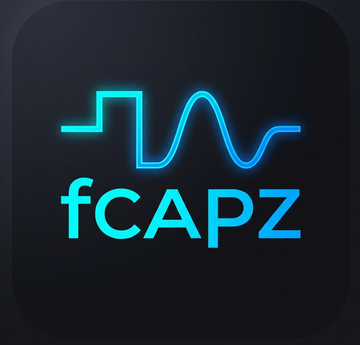
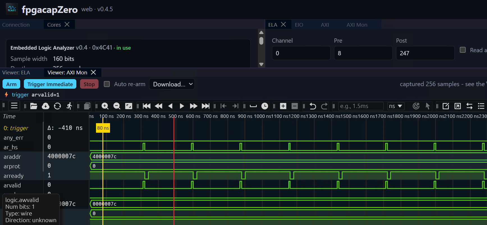

<p align="center">
  
</p>

# fpgacapZero (fcapz)

[](https://github.com/lcapossio/fpgacapZero/actions/workflows/ci.yml)
[](https://github.com/lcapossio/fpgacapZero/blob/main/LICENSE)
[](https://github.com/sponsors/lcapossio)

Open-source FPGA debug cores — in **native Verilog and VHDL** — that you drop
into any design to **see and control what's happening inside your FPGA over
JTAG**: no extra board pins, no soft CPU, no vendor lock-in.

Think of it as an open, vendor-neutral alternative to ChipScope / SignalTap /
Reveal that works the same way across **AMD/Xilinx, Intel/Altera, Lattice, Gowin,
Microchip and Efinix** parts, plus a Python / CLI / web host stack on top.

It is also **built to be driven by AI coding agents**. The bundled
**Model Context Protocol (MCP) server** gives Claude Code, or any other MCP
client, hardware-debug tools to use while it iterates on RTL: connect, set
triggers, capture, search the waveform, and read or write registers on the
real board.

> 📖 **New here? Start with the [User Manual](https://github.com/lcapossio/fpgacapZero/blob/main/docs/README.md)** — especially
> **[First capture in 10 minutes](https://github.com/lcapossio/fpgacapZero/blob/main/docs/03_first_capture.md)**. This page is just
> the quick tour.

## What's in the box

Five small RTL cores, all driven over JTAG:

- **ELA — Embedded Logic Analyzer** — capture internal signals into a waveform
  with flexible triggers, and export to **VCD / CSV / JSON**.
- **AXI monitor** — a passive tap on an AXI4-Lite bus that captures, triggers
  on, and decodes its transactions, error responses included.
- **EIO — Embedded I/O** — read and drive fabric signals live at runtime.
- **EJTAG-AXI** — a JTAG-to-AXI4 master bridge for memory-mapped bus access.
- **EJTAG-UART** — a JTAG-to-UART console bridge.

Plus a host stack: a **browser-based web interface** (`fcapz-web`) with an
embedded **Surfer** waveform viewer that you can reach from the local machine or
across the network, a **Python API**, the **`fcapz` command-line tool**, a
**JSON-RPC server**, and an **MCP server** (`fcapz-mcp`) that exposes the lab
controls to coding agents.

## Why fpgacapZero

- **Vendor-agnostic** — one portable core with thin TAP wrappers for AMD/Xilinx
  7-series, AMD/Xilinx UltraScale / UltraScale+, Lattice ECP5, Intel / Altera,
  Gowin, and Microchip PolarFire-family devices. An **Efinix (Trion / Titanium)**
  wrapper (two JTAG User TAP blocks via the Efinity Interface Designer)
  synthesizes, places and routes in Efinity on Trion and Titanium; hardware
  validation is pending.
- **Small, and only as big as you need** — a usable 8-bit / 1024-sample ELA
  fits in about **600 LUTs + 0.5 BRAM**. Extra triggers, timestamps,
  decimation, segmenting, and more are compile-time options you enable only
  when a design needs them.
- **Verilog *and* VHDL** — the portable core ships as native Verilog and native
  VHDL, with shared regression coverage for both.
- **Apache-2.0** — usable in proprietary designs.

## Let an agent drive the bench

`fcapz-mcp` exposes the lab controls as MCP tools, so a coding agent can
check what the FPGA actually does while it writes the RTL. Register it with
your agent:

```bash
pip install "fpgacapzero[mcp]"
claude mcp add fpgacapzero -- fcapz-mcp --probe-root /abs/path/to/probes
```

`--probe-root` names the directory the agent may load probe maps (such as
`axi.prob` below) from. For a session that only observes, use
`fcapz-mcp --read-only`, which also disables capture control.

- **Results sized for a context window.** A capture returns a summary. The
  agent then pages samples by probe name, jumps to the window around the
  trigger, searches for edges, values or runs of one signal, and reads
  decoded AXI4-Lite transactions with the bus faults first, instead of
  receiving megabytes of raw samples.
- **Self-describing.** `fcapz_list_cores` reports the ELA, AXI monitor and
  EIO cores on the board and their JTAG chains (AXI and UART bridge chains
  are given explicitly). `fcapz_status` reports the session state and what
  the agent is allowed to do, so it learns the policy without being
  refused.
- **Writes are opt-in.** EIO and AXI writes, UART sends and bitstream
  programming are disabled until you enable them. AXI writes can be
  confined to specific address windows, and programming to a directory
  with `--bitfile-root`. `--read-only` additionally disables capture
  control; reads stay available, including UART receives, which consume
  the bytes they read.
- **Long and stuck calls.** Hardware commands run on one owner thread, so a
  concurrent hardware command returns `busy` instead of queueing behind a
  long capture, while status and cached-capture tools stay usable. A
  watchdog bounds every wait; after a timeout the agent reconnects once
  `fcapz_status` reports `ready`.
- **Local or remote.** Use stdio for an agent on the same machine, or HTTPS
  with a bearer token for a bench machine elsewhere on the network.

A typical agent session, chasing a bus fault:

```text
fcapz_connect(backend="hw_server")
fcapz_list_cores()                              # find the AXI monitor's chain
fcapz_connect(backend="hw_server", chain=<monitor chain>)
fcapz_capture(config={"probe_file": "axi.prob", "pretrigger": 32,
                      "posttrigger": 223}, timeout=10.0)
fcapz_axi_transactions(only_anomalies=True)     # error responses and unaligned addresses
fcapz_get_capture_samples(around_trigger=32)    # the raw signals around the trigger
```

Every tool, safety flag and result format is in the
**[MCP server](https://github.com/lcapossio/fpgacapZero/blob/main/docs/20_mcp_server.md)** chapter. Agent frameworks without MCP can
use the same controls through the
[JSON-RPC server](https://github.com/lcapossio/fpgacapZero/blob/main/docs/11_rpc_server.md) or the
[Python API](https://github.com/lcapossio/fpgacapZero/blob/main/docs/09_python_api.md).

## Will it work on my board?

Any board with JTAG access works. You drive it through **OpenOCD** (any
OpenOCD-supported adapter — FTDI, WCH CH347, CMSIS-DAP, J-Link, …), the
**AMD/Xilinx hw_server** (Vivado — hardware-validated on the Arty A7 and on the
Kria KV260, a Zynq UltraScale+ MPSoC), or **Quartus `quartus_stp`**
(Intel/Altera USB-Blaster — hardware-validated on the DE25-Nano / Agilex 5), or
**directly over an FTDI cable** (`--backend ftdi`: the FlashPro5 on Microchip
boards, a Digilent cable, or any FT2232H/FT4232H, with no OpenOCD or vendor
server — hardware-validated through FTDI's D2XX driver on the PolarFire SoC
Discovery Kit, the Arty A7, where it also programs the bitstream, and the
Kria KV260, where it reaches the FPGA past the ARM DAP on the JTAG chain;
the libusb driver and multi-device chains are on `main`, not yet in a
release, and libusb is validated for raw JTAG scans only). A board with **no JTAG to the fabric** can
use the **serial TAP bridge** instead: two spare pins and a UART
(`--backend serial`; hardware-validated on the Forgix board's Efinix Trion). On
Zynq UltraScale+ MPSoC parts (`xck*`, `xczu*`) the host picks the PS TAP's
chain mode from the tap name, so all four USER chains work with no extra
setup. The
full per-vendor matrix and JTAG-chain rules are in the manual's
[RTL integration chapter](https://github.com/lcapossio/fpgacapZero/blob/main/docs/04_rtl_integration.md); see also
[Support status](#support-status) below.

## Quick start

You need Python 3.10+, an FPGA board, and a supported transport: Vivado
hw_server, OpenOCD, Quartus `quartus_stp` (Intel/Altera USB-Blaster), a
direct FTDI cable, or the serial TAP bridge. Full setup is in
[Installation](https://github.com/lcapossio/fpgacapZero/blob/main/docs/02_install.md).

```bash
git clone https://github.com/lcapossio/fpgacapZero.git
cd fpgacapZero
pip install -e ".[web]"      # core host stack + web interface
fcapz-web                    # the easiest way to take your first capture
```

Then open **http://127.0.0.1:7373** in your browser: connect to the board, arm
an ELA capture with the run controls, set triggers, and inspect the result in
the embedded **Surfer** waveform viewer — EIO and JTAG-AXI live there too. It
runs over the same JSON-RPC API as the rest of the stack and can be exposed
across the network with a bearer token. See
**[Web interface](https://github.com/lcapossio/fpgacapZero/blob/main/docs/18_web_interface.md)**.

<p align="center">
  
</p>

Prefer the command line? Build the Arty A7 reference bitstream (see
[Build from source](#build-from-source) — or use your own), then capture:

```bash
fcapz --backend hw_server --port 3121 \
  --program examples/arty_a7/arty_a7_vex_top.bit \
  capture --trigger-value 0 --trigger-mask 0xFF --out capture.vcd --format vcd
```

The end-to-end walkthrough lives in
**[First capture in 10 minutes](https://github.com/lcapossio/fpgacapZero/blob/main/docs/03_first_capture.md)**. For every command
and flag, see the [CLI reference](https://github.com/lcapossio/fpgacapZero/blob/main/docs/10_cli_reference.md); for scripting, the
[Python API](https://github.com/lcapossio/fpgacapZero/blob/main/docs/09_python_api.md) (every signature in the
[API reference](https://github.com/lcapossio/fpgacapZero/blob/main/docs/specs/python_api.md)) and [JSON-RPC server](https://github.com/lcapossio/fpgacapZero/blob/main/docs/11_rpc_server.md).
To hand the bench to a coding agent instead, see
[Let an agent drive the bench](#let-an-agent-drive-the-bench).

## Add it to your design

One instantiation per core — swap the wrapper suffix to match your FPGA vendor:

```verilog
wire [127:0] my_signals;

// Embedded Logic Analyzer (all JTAG plumbing bundled inside the wrapper)
fcapz_ela_xilinx7 #(.SAMPLE_W(128), .DEPTH(4096)) u_ela (
    .sample_clk (sys_clk),
    .sample_rst (reset),
    .probe_in   (my_signals)
);
```

That's the minimal ELA. Wrapper names follow `fcapz_<core>_<vendor>` (e.g.
`fcapz_ela_ecp5`, `fcapz_eio_intel`). Every parameter, the EIO / AXI / UART
cores, LiteX integration, VHDL sources under `rtl/vhdl/`, and the per-vendor
JTAG-chain rules are covered in **[RTL integration](https://github.com/lcapossio/fpgacapZero/blob/main/docs/04_rtl_integration.md)**.
The canonical register / shift maps live in
[`docs/specs/register_map.md`](https://github.com/lcapossio/fpgacapZero/blob/main/docs/specs/register_map.md).

## Support status

| Area | Status |
|------|--------|
| AMD/Xilinx `hw_server` backend | ✅ Hardware-validated on Arty A7 and Kria KV260 (Zynq UltraScale+ MPSoC) |
| OpenOCD backend | ✅ Hardware-validated on Gowin BRS-100 and the PolarFire SoC Discovery Kit; AMD/Xilinx/OpenOCD path still less exercised than `hw_server` |
| Quartus USB-Blaster (`quartus_stp`) backend | ✅ Hardware-validated on DE25-Nano (Agilex 5) |
| Direct FTDI backend (`--backend ftdi`, D2XX or libusb) | ✅ Hardware-validated over D2XX on the PolarFire SoC Discovery Kit's embedded FlashPro5, the Arty A7 (including 7-series programming) and the Kria KV260 (multi-device JTAG chain, on `main`); libusb (on `main`, unreleased) validated for raw JTAG scans only, full sessions not yet |
| Serial TAP bridge (`--backend serial`, `fcapz_ela_uart`) | ✅ Hardware-validated on Forgix (Efinix Trion T8F49, over its configuration pins) |
| AMD/Xilinx 7-series wrappers | ✅ Hardware-validated on Arty A7-100T |
| Gowin wrapper | ✅ Hardware-validated on BRS-100-GW1NR9 |
| Intel / Altera wrapper | ✅ Hardware-validated on DE25-Nano (Agilex 5) via USB-Blaster |
| Microchip PolarFire wrapper | ✅ Hardware-validated on the PolarFire SoC Discovery Kit (MPFS095T) over OpenOCD |
| AMD/Xilinx UltraScale / UltraScale+ wrappers | ✅ Hardware-validated on Kria KV260 (`xck26`) and on a Kintex UltraScale KU035 (proprietary board); standalone UltraScale+ not yet tested |
| ECP5 wrappers | RTL complete; host / hardware validation still limited |
| Efinix (Trion / Titanium) wrapper | ⏳ Synthesized, placed and routed in Efinity 2025.1 (Trion T20F256, Titanium Ti60F225); hardware validation pending |
| ELA / EIO / EJTAG-AXI / EJTAG-UART | ✅ Validated on Arty A7 and Kria KV260 (details in the manual) |

The full, always-current matrix is in [Overview](https://github.com/lcapossio/fpgacapZero/blob/main/docs/01_overview.md) and
[RTL integration](https://github.com/lcapossio/fpgacapZero/blob/main/docs/04_rtl_integration.md).

## Build from source

```bash
# Build the Arty A7 reference bitstream (Vivado)
python examples/arty_a7/build.py

# Or the Kria KV260 one (Zynq UltraScale+ MPSoC; needs the kv260_som board files)
python examples/kv260/build.py

# Run the host test suite — no hardware needed
pip install -e ".[dev,hdl]"
pytest tests/ -v
```

RTL simulation (Icarus / Verilator / cocotb / GHDL), the VHDL parity gates, the
CI jobs, and the hardware-in-the-loop tests are all documented in
**[CONTRIBUTING.md](https://github.com/lcapossio/fpgacapZero/blob/main/CONTRIBUTING.md)**. Live CI status is the badge at the top.

## Project layout

```
rtl/        Portable Verilog cores + vendor TAP wrappers (VHDL in rtl/vhdl/)
host/fcapz/ Python host stack: Analyzer, transports, CLI, RPC, web, MCP
examples/   Reference designs (Arty A7, Kria KV260, DE25-Nano, Gowin BRS-100,
            PolarFire SoC Discovery Kit, Forgix, and more)
docs/       User manual (start at docs/README.md) + canonical specs
tb/, sim/   Testbenches and simulation runners
```

## Project links

- 📖 **[User Manual](https://github.com/lcapossio/fpgacapZero/blob/main/docs/README.md)** — the complete guide; it also builds into a searchable
  [HTML site](https://github.com/lcapossio/fpgacapZero/blob/main/docs/README.md#reading-the-manual-as-html) (`mkdocs serve`)
- 📝 **[CHANGELOG](https://github.com/lcapossio/fpgacapZero/blob/main/CHANGELOG.md)** — releases, with breaking changes called out
- 🤝 **[CONTRIBUTING](https://github.com/lcapossio/fpgacapZero/blob/main/CONTRIBUTING.md)** — dev setup, testing, adding a board
- 🐛 **[Troubleshooting](https://github.com/lcapossio/fpgacapZero/blob/main/docs/17_troubleshooting.md)** — common errors and fixes

## Author

Leonardo Capossio — [bard0 design](https://www.bard0.com) — <hello@bard0.com>

## Contributors

- [Brisbane Silicon](https://github.com/BrisbaneSilicon)

## Sponsoring

If fpgacapZero helps your FPGA debug flow, you can support continued
development through [GitHub Sponsors](https://github.com/sponsors/lcapossio).

## License

Apache License 2.0 — see [LICENSE](https://github.com/lcapossio/fpgacapZero/blob/main/LICENSE) for details.
