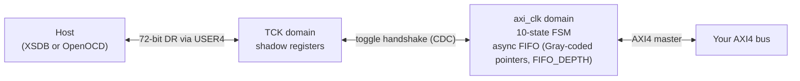

# 07 — EJTAG-AXI bridge

> [!NOTE]
> **Goal**: deep dive on the JTAG-to-AXI4 master bridge.  By the end
> of this chapter you will know how the bridge moves bytes between
> JTAG and your AXI bus, what FIFO_DEPTH means and why the host
> protects you from overflowing it, the difference between single /
> auto-increment / burst transfers, and the AXI4 subset that is
> actually supported.

## What it is

The EJTAG-AXI bridge is a **JTAG-to-AXI4 master**.  It lives on
JTAG USER4 (CHAIN=4) and exposes a 32-bit memory-mapped AXI bus on
the FPGA side.  The host PC can issue AXI4 read and write
transactions over JTAG, the same way it would from a CPU debugger.

The fcapz bridge is **vendor-agnostic** (the protocol is standard
JTAG plus a custom 72-bit DR), the source is yours, the host stack
is Python, and you can read every line of the FSM in
[`../rtl/fcapz_ejtagaxi.v`](../rtl/fcapz_ejtagaxi.v).

> [!TIP]
> **See also:** the EJTAG-AXI bridge *drives* an AXI bus (it is a master). To
> *observe* one passively — capture and trigger on transactions without
> perturbing them — use the [AXI monitor](19_axi_monitor.md).

## What it can do

- **Single AXI read** — one address, one data word.
- **Single AXI write** — one address, one data word, with byte-level
  write strobes (`wstrb`).
- **Auto-increment block read** — sequential reads from `base+0`,
  `base+4`, `base+8`, ...  Uses one shared address phase per scan
  (the bridge increments internally).
- **Auto-increment block write** — sequential writes to the same
  pattern.  ~10× faster than calling single-write in a loop because
  the round-trip is amortised over the batch.
- **AXI4 burst read** — a single AXI4 burst transaction with up to
  `FIFO_DEPTH` beats.  The bridge starts the burst on the AXI side,
  the AXI slave streams beats into an async FIFO inside the bridge,
  the host scans them out.
- **AXI4 burst write** — a single AXI4 burst write with up to
  `FIFO_DEPTH` beats.  The host paces the writes one per JTAG scan;
  the bridge returns one completion per beat so the host
  knows when to send the next beat.
- **Streaming read** (opt-in, `STREAM_EN=1`) — up to 16383 words per
  long DR scan, so the cable sets the rate instead of the per-scan
  tool overhead.  See [Streaming read](#streaming-read).

What it **can't** do (yet):

- AXI3 (`wid` field).  AXI4 dropped `wid` so this is fine for any
  modern design.
- 64-bit data width.  Only `DATA_W=32` is supported today.
- Outstanding multiple-transaction issuing.  One in flight at a time.
- Out-of-order responses.  The bridge expects in-order responses
  from the slave (true for almost all real AXI slaves).

## Architecture



The **TCK domain** holds a 72-bit shift register that the host
loads with a command + address + data + wstrb on every scan.  On
DR update, the parsed fields are packed into a registered command
word and pushed into a **TCK-to-AXI async command FIFO**.

The **`axi_clk` domain** runs a 10-state FSM that drives the AXI
master interface (`m_axi_*`).  Completed responses cross back to
TCK through an **AXI-to-TCK async response FIFO**.  Burst reads use
that response path plus a dedicated read FIFO so the AXI side can
fill data while the host scans words out one per shift.

Burst writes use one completion per beat through the same response
path.  This keeps the inter-beat pacing host-controlled; the AXI
side never times out between beats, only on the AXI handshake waits
themselves (`wready`, `bvalid`, `arready`, `rvalid`).

A read whose address the slave has accepted is never abandoned on the
R channel.  If it times out waiting for `rvalid`, or a RESET cuts it
off, the bridge keeps `rready` high and discards the late beats up to
`rlast`, however late they come, so they cannot come back as the data
of a later read.  The next command waits for them up to `TIMEOUT`
cycles without a beat; after that, writes and CONFIG run normally,
while reads answer SLVERR without touching the bus until the owed
beats have arrived.  A slave that never answers therefore costs
SLVERRs, not a hung bridge.

## The 72-bit DR shift format

Every JTAG scan moves exactly 72 bits in and 72 bits out.  The
shift-out is the result of the **previous** scan — pipelined, no
polling.

**Shift-in (host → FPGA):**

| Bits | Field | Description |
|---|---|---|
| `[31:0]` | addr | AXI address (or config register address) |
| `[63:32]` | payload | Write data (or burst config word) |
| `[67:64]` | wstrb | AXI write strobes |
| `[71:68]` | cmd | Command code (see table below) |

**Shift-out (FPGA → host):**

| Bits | Field | Description |
|---|---|---|
| `[31:0]` | rdata | Read data from the previous command |
| `[63:32]` | info | Address echo or burst count |
| `[65:64]` | resp | AXI response code (OKAY=0, SLVERR=2, DECERR=3) |
| `[67:66]` | rsvd | Reserved |
| `[71:68]` | status | Status bits |

**Command table:**

| Code | Mnemonic | Description |
|---|---|---|
| `0x0` | NOP | No operation; retrieves previous result |
| `0x1` | WRITE | Single AXI write at addr |
| `0x2` | READ | Single AXI read at addr |
| `0x3` | WRITE_INC | Write at auto-increment address |
| `0x4` | READ_INC | Read at auto-increment address |
| `0x5` | SET_ADDR | Set the auto-increment base address |
| `0x6` | BURST_SETUP | Configure burst (len, size, type in payload) |
| `0x7` | BURST_WDATA | Push one word into burst write buffer |
| `0x8` | BURST_RDATA | Pop one word from burst read FIFO |
| `0x9` | BURST_RSTART | Initiate burst read (starts the address phase) |
| `0xA` | STREAM_RSTART | Start a streaming read (addr = start, payload = word count); `STREAM_EN=1` only |
| `0xE` | CONFIG | Read bridge config register (addr selects which) |
| `0xF` | RESET | Reset bridge state machines |

**Status bits `[71:68]`:**

| Bit | Meaning |
|---|---|
| 0 | `prev_valid` — `rdata`/`resp` are from a completed operation |
| 1 | `busy` — AXI transaction in flight (should not normally be seen) |
| 2 | `error` — sticky, last operation got non-OKAY AXI response |
| 3 | `fifo_notempty` — burst read FIFO has data available |

You don't need to memorise this table.  The host stack speaks the
protocol for you — you call `bridge.axi_read(0x40000000)` and the
controller takes care of building the right shift words and
parsing the responses.  The table is here so you can read the
register-map spec ([`specs/register_map.md`](specs/register_map.md))
and the RTL FSM in [`fcapz_ejtagaxi.v`](../rtl/fcapz_ejtagaxi.v)
without having to reverse-engineer the encoding.

## The host API: `EjtagAxiController`

```python
from fcapz import XilinxHwServerTransport, EjtagAxiController

t = XilinxHwServerTransport(port=3121, fpga_name="xc7a100t")
bridge = EjtagAxiController(t, chain=4)
info = bridge.connect()
print(info)
# {
#   "bridge_id": 0x4A58,        # ASCII "JX"
#   "core_id": 0x4A58,
#   "legacy_id": False,
#   "legacy_raw_id": None,
#   "version": 0x00054A58,
#   "version_major": 0,
#   "version_minor": 5,
#   "addr_w": 32,
#   "data_w": 32,
#   "fifo_depth": 16,            # <-- cached from FEATURES register
#   "stream": False,             # FEATURES[24]: streaming read built in
# }
```

After `connect()`, the controller has:

- Verified the bridge identity (`VERSION[15:0] = 0x4A58 = "JX"`).
  Old bitstreams that still report `BRIDGE_ID = 0x454A4158` (`"EJAX"`)
  are accepted with a `RuntimeWarning`.
  In both cases `info["bridge_id"]` and `info["core_id"]` are the
  normalized 16-bit `JX` value; old bitstreams additionally report
  `legacy_id=True` and `legacy_raw_id=0x454A4158`; new bitstreams report
  `legacy_id=False` and `legacy_raw_id=None`.
- Cached `FIFO_DEPTH` from the `FEATURES` register.  This is the
  maximum burst length the bridge can buffer.  Every subsequent
  `burst_read()` / `burst_write()` checks the requested count
  against this and rejects oversized requests at the API boundary
  with a clear error message — see "FIFO_DEPTH guard rails" below.
- Cached whether the bitstream has the streaming read
  (`FEATURES[24]`, `bridge.has_stream()`).

### Single read

```python
value = bridge.axi_read(0x40000000)        # returns int
```

Two JTAG scans: one to issue the READ command, one NOP to wait
until `prev_valid` is set and read the data back.

When running over AMD/Xilinx `hw_server` / `xsdb`, the host may batch
that command and its drain scans into one USER4 raw-scan sequence
internally.  That is a transport detail; the bridge protocol is the
same.

### Single write

```python
resp = bridge.axi_write(0x40000000, 0xDEADBEEF)
# resp == 0 (OKAY) on success
# resp == 2 (SLVERR) or 3 (DECERR) on failure → raises AXIError
```

Two scans.  Wstrb defaults to `0xF` (write all four bytes).  Pass
`wstrb=0x3` to write only the low two bytes:

```python
bridge.axi_write(0x40000000, 0x0000ABCD, wstrb=0x3)
```

### Auto-increment block read

```python
words = bridge.read_block(0x40000000, count=64)    # returns list[int]
```

Issues one `SET_ADDR` then `count` `READ_INC` commands plus a NOP
drain, all in **one batched JTAG sequence** via `raw_dr_scan_batch()`.
It is much faster than issuing one single read per word because the
inter-scan tool overhead is amortised in one batch.

### Auto-increment block write

```python
bridge.write_block(0x40000000, [0xAA00, 0xAA01, 0xAA02, ...])
```

Same shape, the other direction.

### Transport note: USER4 batching on Arty / hw_server

On the Arty A7 reference setup with `XilinxHwServerTransport`,
isolated USER4 `raw_dr_scan()` calls were observed to return
all-zero TDO even though the EJTAG-AXI bridge was alive and
answering correctly.  The same USER4 transactions worked when they
were issued inside one `raw_dr_scan_batch()` / single XSDB
`jtag sequence`.

Because of that, `EjtagAxiController` prefers batched USER4 scan
sequences for connect, single transactions, block traffic, and
bursts when running over `hw_server`.  This is a host transport
reliability detail, not a different RTL protocol.

### AXI4 burst read

```python
words = bridge.burst_read(0x40000000, count=16)
```

This issues a real AXI4 burst transaction (one address phase,
multiple data beats).  The bridge starts the burst, the AXI slave
streams beats into the async FIFO, the host scans them out one
beat per JTAG scan.

**Constraints:**

- `1 ≤ count ≤ FIFO_DEPTH` — the bridge cannot buffer more beats
  than its FIFO holds.  The host enforces this and raises
  `ValueError` with a remediation hint that tells you to rebuild
  the bitstream with a larger `FIFO_DEPTH` parameter if you need
  longer bursts.
- `count ≤ 256` — AXI4 maximum burst length.

### AXI4 burst write

```python
bridge.burst_write(0x40000000, [0xAA, 0xBB, 0xCC, 0xDD])
```

Same constraints as `burst_read`.  The host paces beats one per
scan; the bridge per-beat-acks so the host knows when to queue the
next beat.

### Streaming read

```python
if bridge.has_stream():
    words = bridge.stream_read(0x80000000, count=262144)   # 1 MiB
```

Block and burst reads cost one 72-bit scan per word, and every scan
pays the tool's per-scan overhead: a few KB/s whatever the cable.
The streaming read moves up to 16383 words in one long DR scan
(`slots_per_scan` changes it), so the cable's shift rate sets the
speed.  Measured on the Arty A7 reference design (`arty_a7_vex_top`,
onboard FT2232H cable, `hw_server`, TCK 30 MHz): about 1.9 MB/s for
a 4 MiB read, against 6 KB/s for `read_block`.  That is about what
`hw_server` shifts through that cable (about 18 Mbit/s at TCK
30 MHz), so over `hw_server` the TCK rate is what is left to tune:
check or set it in xsdb with `jtag frequency` (hw_server keeps it
per cable).  The same cable driven directly by
[`FtdiMpsseTransport`](14_transports.md#ftdimpssetransport) at 30 MHz
reads about 2.8 MB/s.

It is built only when the bridge has `STREAM_EN=1` (default 0, about
200 LUTs and 200 FFs, no BRAM; Verilog core only for now):

```verilog
fcapz_ejtagaxi_xilinx7 #(
    .FIFO_DEPTH (256),
    .STREAM_EN  (1)
) u_axi ( ... );
```

The bridge announces it in `FEATURES[24]`.  On a bitstream without it
`stream_read()` raises `RuntimeError`; `read_block()` and
`burst_read()` keep working either way.

**Protocol.**  `CMD_STREAM_RSTART` (addr = start, payload = word
count) switches the 72-bit DR into stream mode.  The AXI side then
reads the range in INCR bursts of `FIFO_DEPTH/4` beats that never
cross a 4 KB boundary, and starts a burst only when the burst FIFO
has room for all of it, so the slave is never back-pressured.  From
then on every DR scan, of any length, shifts out 33-bit slots
`{data[31:0], valid}`, LSB first:

- Slot 0 is a header: `valid = 0`, `data` = words not yet delivered.
- A slot with `valid = 1` carries the next word; `valid = 0` means
  the FIFO was empty and nothing was consumed.
- A word counts as delivered only once all 33 bits are out; a scan
  that ends inside a slot gets that word again in the next scan.
- TDI must stay 0.  Any 1 shifted in aborts the stream like
  `CMD_RESET`.
- Stream mode ends at the UPDATE of the first scan whose header reads
  0, so the host ends with a 33-bit header-only scan.  The next normal
  scan returns the range's AXI response (the first non-OKAY one).

**Host rules.**  `stream_read()` keeps a scan's words only after the
next scan's header confirms how many the bridge handed out, so a lost
or repeated word is always caught.  On a header mismatch, a stall or a
transport error it aborts the stream and reads the **whole** range
again (up to `retries` times), because an aborted stream's AXI
response is never seen.  Words are returned only after the final
response reads OKAY, and the stream is aborted before any error is
raised, so the bridge is back in normal mode for the next command.

**Chain lock.**  A stream lives across many scans, and another
client's scan of the same USER chain with a 1 in it aborts the
stream.  On `hw_server` other clients (a soft-CPU debugger, the
Vivado hardware manager, hw_server's own polls) scan every few tens
of milliseconds, so each attempt holds xsdb's `jtag lock`
(`XilinxHwServerTransport.jtag_lock()` / `jtag_unlock()`), the final
abort included.  Other transports have no lock and fall back to one
`raw_dr_scan()` per scan; the streaming read has only been tested on
hardware over `hw_server`.

### Closing

```python
bridge.close()        # sends RESET, drains, closes the transport
```

`close()` is best-effort: if the RESET command fails (transport
already dead, etc.), it warns via `RuntimeWarning` instead of
swallowing the error silently.

## FIFO_DEPTH guard rails

The bridge has an on-chip async FIFO between the AXI side and the
JTAG side, sized by the `FIFO_DEPTH` parameter at build time
(default 16, max 256, must be a power of 2).

When you call `burst_read(addr, count=N)` or `burst_write()` with an
N-word `data` list, the host checks (it does not split the burst):

```python
if count > self._fifo_depth:
    raise ValueError(
        f"burst_read: count {count} exceeds bridge FIFO_DEPTH "
        f"({self._fifo_depth}); rebuild bitstream with larger FIFO_DEPTH"
    )
```

This catches an oversized burst at the host API boundary, with a
clear error message that points at the fix (rebuild with a bigger
`FIFO_DEPTH`).

On the AXI side a burst read is flow-controlled exactly: while the
bridge fills the FIFO, `rready` is the FIFO's own not-full, and a beat
is written in the same cycle it is accepted.  A full FIFO holds the
slave off until the host pops a beat, and no beat is dropped or
written twice.  The AMD/Xilinx XPM FIFO reports full one entry early
(`FIFO_DEPTH - 1`), so the last beat of a full-depth burst simply
waits for the host's first pop.  (Before this was fixed, a registered
`rready` accepted a beat in the cycle the FIFO filled and dropped it,
so a 16-beat read on a 16-deep XPM FIFO failed with SLVERR.)

The host learns the bitstream's FIFO_DEPTH from the FEATURES
register at `0x002C`:

```
FEATURES[7:0]   = ADDR_W
FEATURES[15:8]  = DATA_W
FEATURES[23:16] = FIFO_DEPTH - 1   (AXI4 awlen convention so 256 fits in 8 bits)
FEATURES[24]    = STREAM_ON        (streaming read built in)
```

So `FIFO_DEPTH=16` is encoded as `0x0F` in the bitstream and the
host adds 1 to recover the true depth.  See
[`specs/register_map.md`](specs/register_map.md).

If you want longer bursts than 16, rebuild your bitstream with a
larger parameter:

```verilog
fcapz_ejtagaxi_xilinx7 #(
    .ADDR_W     (32),
    .DATA_W     (32),
    .FIFO_DEPTH (256)        // ← was 16
) u_axi ( ... );
```

The default 16 is a deliberate compromise: enough for most CSR
register dumps and small block transfers, small enough that the
default burst FIFO remains small. On AMD/Xilinx XPM builds, bumping to
256 moves the burst buffer into BRAM rather than exploding LUT use,
but it does spend another RAMB18 tile to enable full AXI4 max bursts.

`CMD_FIFO_DEPTH` and `RESP_FIFO_DEPTH` size the separate command and
response queues between TCK and `axi_clk`. Their wrapper defaults track
the core default (`2*FIFO_DEPTH`) for compatibility with aggressively
batched host traffic, but they can be set independently when BRAM is
tighter than queue depth. On AMD/Xilinx XPM FIFO builds, the minimum legal
depth is 16. The Arty A7 reference uses:

```verilog
.FIFO_DEPTH      (16),
.CMD_FIFO_DEPTH  (16),
.RESP_FIFO_DEPTH (16),
.CMD_FIFO_MEMORY_TYPE("distributed")
```

This keeps the same 16-beat burst limit while avoiding the extra BRAM
tiles that Vivado otherwise spends on the default 32-deep response queue
and the wide command queue. Leave the memory-type selectors at `"auto"`
unless you have checked the target tool's utilization result; forcing
large FIFOs into distributed RAM can quickly cost more LUTs than it saves.
In the Arty reference, the 16-entry response queue already maps out of
BRAM with `"auto"`, so only the command queue needs an explicit
`"distributed"` override.

`DEBUG_EN` defaults to `0` on the core and vendor wrappers. Leave it
off for production builds so synthesis can prune the 256-bit debug
buses, capture-record storage, and debug-only counters; enable it only
when wiring those buses into an on-chip analyzer.

Those debug buses are internal development telemetry, not a stable host
or register-map API. They expose snapshots of the TCK-side command
pipeline, AXI-side launch/response state, and a few short capture
records used while wiring an ILA. The exact bit layout may change with
the bridge implementation; production designs should use the documented
JTAG command protocol and CONFIG registers instead.

## Throughput

Sustained data rate depends on the JTAG adapter, cable, and whether the
transport batches multiple DR shifts in one round trip
(`raw_dr_scan_batch`).  **Single** `axi_read` / `axi_write` calls pay
about one host round trip each.  **Auto-increment** `read_block` /
`write_block` and **AXI4 burst** paths pack many fabric transactions
behind fewer JTAG exchanges.  The bottleneck is **not** the bridge
itself — the `axi_clk` FSM runs at full speed — it is JTAG-side pacing
through the host tool.

Different adapters or a transport that bypasses per-scan tool overhead
would change what you measure on the wire.

## CLI usage

For interactive debug, the CLI is fastest:

```bash
# Single ops
$ fcapz axi-read --addr 0x40000000
0xDEADBEEF
$ fcapz axi-write --addr 0x40000000 --data 0x12345678 --wstrb 0xF
wrote 0x12345678 -> 0x40000000 (resp=0)

# Block dump (auto-increment)
$ fcapz axi-dump --addr 0x40000000 --count 16
0x40000000: 0x12345678
0x40000004: 0x00000001
0x40000008: 0x00000002
...
$ fcapz axi-dump --addr 0x40000000 --count 16 --burst    # AXI4 burst variant

# Block fill
$ fcapz axi-fill --addr 0x40000000 --count 64 --pattern 0xAA55AA55

# Load a binary file
$ fcapz axi-load --addr 0x10000000 --file firmware.bin
loaded 4096 words @ 0x10000000
```

`--burst` on `axi-dump` / `axi-fill` switches from auto-increment
mode to AXI4 burst mode.  Use it when your slave actually supports
bursts (most do); skip it when it doesn't (some legacy slaves only
do single transactions).

See [chapter 10](10_cli_reference.md) for the full CLI reference.

## Worked example: dump 256 bytes from BRAM

```python
from fcapz import XilinxHwServerTransport, EjtagAxiController

t = XilinxHwServerTransport(
    port=3121, fpga_name="xc7a100t",
    bitfile="my_design.bit",
)
bridge = EjtagAxiController(t, chain=4)
bridge.connect()

# Read 64 32-bit words = 256 bytes from BRAM at 0x10000000
words = bridge.read_block(0x10000000, count=64)

# Print as hexdump
for i, w in enumerate(words):
    if i % 4 == 0:
        print(f"\n{0x10000000 + i*4:08X}:", end="")
    print(f" {w:08X}", end="")
print()

bridge.close()
```

## Worked example: load a small firmware image into BRAM

```python
import struct
from pathlib import Path
from fcapz import XilinxHwServerTransport, EjtagAxiController

# Read the binary file as little-endian 32-bit words
data = Path("firmware.bin").read_bytes()
if len(data) % 4 != 0:
    data += b"\x00" * (4 - len(data) % 4)
words = list(struct.unpack(f"<{len(data) // 4}I", data))

t = XilinxHwServerTransport(port=3121, fpga_name="xc7a100t")
bridge = EjtagAxiController(t, chain=4)
bridge.connect()

# Auto-increment block write at 0x10000000
bridge.write_block(0x10000000, words)
print(f"loaded {len(words)} words ({len(data)} bytes)")

# Verify by reading back
verify = bridge.read_block(0x10000000, len(words))
assert verify == words, "verify mismatch!"
print("verified")

bridge.close()
```

This is the same logic as the `fcapz axi-load` CLI subcommand.

## Worked example: drive an AXI peripheral

Suppose your design has a memory-mapped UART at `0x44000000` with
a TX FIFO at offset `0x00`, RX at `0x04`, and a status register at
`0x08`:

```python
TX_FIFO    = 0x44000000
RX_FIFO    = 0x44000004
STATUS_REG = 0x44000008
TX_FULL    = 1 << 0
RX_VALID   = 1 << 1

bridge = EjtagAxiController(transport, chain=4)
bridge.connect()

# Send "Hello\n"
for ch in "Hello\n":
    while bridge.axi_read(STATUS_REG) & TX_FULL:
        pass     # spin until TX FIFO has room
    bridge.axi_write(TX_FIFO, ord(ch))

# Receive whatever is in the RX FIFO
received = []
while bridge.axi_read(STATUS_REG) & RX_VALID:
    received.append(chr(bridge.axi_read(RX_FIFO) & 0xFF))
print("".join(received))

bridge.close()
```

This is a slow way to drive a UART (one JTAG round-trip per byte),
but it works without writing a single line of RTL
beyond the AXI peripheral itself.  For a real UART workflow, use
the **EJTAG-UART bridge** instead — see [chapter 08](08_ejtag_uart_bridge.md).

## Testing

Hardware integration tests in
[`../examples/arty_a7/test_hw_integration.py`](../examples/arty_a7/test_hw_integration.py)
exercise the bridge end-to-end on real silicon:

| Test | What it covers |
|---|---|
| `test_bridge_probe` | `connect()` + identity + FEATURES decoding (incl. FIFO_DEPTH) |
| `test_single_write_read_roundtrip` | Single AXI write then read back, four patterns |
| `test_write_strobe_partial` | `wstrb=0x3` writes only the low 2 bytes |
| `test_write_block_read_block` | 16 words via auto-increment |
| `test_burst_read` | 8-beat AXI4 burst read |
| `test_burst_write_read` | 8-beat AXI4 burst write + verify via burst read |
| `test_error_on_error_addr` | Slave returns SLVERR → host raises `AXIError` |
| `test_throughput` | 256-word block write, wall-clock timing |

The on-chip test slave is in
[`../tb/axi4_test_slave.v`](../tb/axi4_test_slave.v) — a small
register file that supports auto-increment, bursts, and an
"error address" (`0xFFFFFFFC`) that always responds with `SLVERR`
so the error path can be tested.

Unit tests in [`../tests/test_ejtagaxi.py`](../tests/test_ejtagaxi.py)
cover the controller against a `FakeBridgeTransport` that simulates
the 72-bit pipelined DR protocol — no hardware needed.

## What's next

- [Chapter 08 — EJTAG-UART bridge](08_ejtag_uart_bridge.md): the
  sibling bridge for UART traffic over JTAG.
- [Chapter 09 — Python API](09_python_api.md): full
  `EjtagAxiController` API reference.
- [Chapter 10 — CLI reference](10_cli_reference.md): the `axi-*`
  subcommands.
- [Chapter 17 — Troubleshooting](17_troubleshooting.md): common
  AXI bridge errors (SLVERR, FIFO overflow, busy retry exceeded).
- [`specs/register_map.md`](specs/register_map.md): full
  EJTAG-AXI register map and 72-bit DR encoding.
