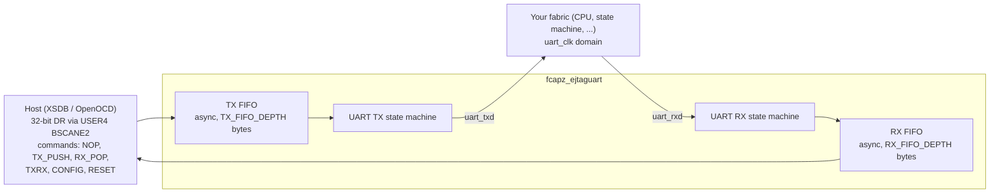

# 08 — EJTAG-UART bridge

> [!NOTE]
> **Goal**: deep dive on the JTAG-to-UART bridge.  By the end of
> this chapter you will know how to wire it into your design, how
> to send and receive bytes from the host, and what the known
> dropped-byte issue (BUG-002) turned out to be.

## What it is

The EJTAG-UART bridge gives the host PC a **bidirectional UART**
to your design over JTAG, with TX and RX async FIFOs, **without
burning a physical UART pin** on your FPGA package and **without
wiring up a USB-serial adapter**.  The bridge lives on JTAG USER4
(CHAIN=4), the same chain as the EJTAG-AXI bridge — they're
mutually exclusive in any one bitstream.

Use cases that just work:

- A small softcore (PicoRV32, Ibex, NEORV32, ...) prints to the
  bridge instead of a physical UART pin.  The host streams the
  output with `fcapz uart-recv`.
- The host uploads a small firmware image into BRAM via the AXI
  bridge, then resets the CPU and watches the boot output stream
  back via the UART bridge (in two separate bitstreams, since
  they share USER4).
- Debug `printf` over JTAG without ever wiring a UART pin.
- Two FPGAs talk over JTAG via two separate `fcapz uart-*` host
  sessions.

## Architecture



The host scans 32 bits in and 32 bits out per JTAG transaction.
Inside that 32 bits the host packs a 4-bit command, an 8-bit TX
byte (if it's pushing one), and reads back the next RX byte (if
one is available) plus status flags.

The TX and RX paths each have a **Gray-coded async FIFO** so the
TCK domain (host) and the `uart_clk` domain (UART hardware) can
run at completely independent rates.  This is the same
[`fcapz_async_fifo.v`](../rtl/fcapz_async_fifo.v) used by the
EJTAG-AXI bridge for burst reads, with `USE_BEHAV_ASYNC_FIFO=0`
selecting the AMD/Xilinx XPM variant for synthesis (or
`USE_BEHAV_ASYNC_FIFO=1` for the portable behavioral version).

## The 32-bit DR shift format

| Bits | Field | Description |
|---|---|---|
| `[7:0]` | tx_byte | Byte to push into TX FIFO (if cmd = TX_PUSH or TXRX) |
| `[27:8]` | reserved | Must be zero |
| `[31:28]` | cmd | Command code |

**Shift-out:**

| Bits | Field | Description |
|---|---|---|
| `[7:0]` | rx_byte | Byte popped from RX FIFO (if previous cmd was RX_POP) |
| `[15:8]` | tx_free | TX FIFO free space (conservative lower bound) |
| `[23:16]` | reserved | Zero |
| `[24]` | RX_READY | RX FIFO has data |
| `[28]` | RX_VALID | This `rx_byte` is valid |
| `[29]` | TX_FULL | TX FIFO is full |
| `[30]` | RX_OVERFLOW | RX FIFO overflowed (sticky, cleared by RESET) |
| `[31]` | FRAME_ERR | UART framing/parity error (sticky) |

**Commands:**

| Code | Mnemonic | Description |
|---|---|---|
| `0x0` | NOP | No operation; reads status |
| `0x1` | TX_PUSH | Push `tx_byte` into TX FIFO |
| `0x2` | RX_POP | Pop one byte from RX FIFO; result on next scan |
| `0x3` | TXRX | TX_PUSH and RX_POP in the same scan (full duplex) |
| `0xE` | CONFIG | Read config register byte (selected by `tx_byte` field) |
| `0xF` | RESET | Reset bridge state machines + flush FIFOs |

The `tx_free` field is a **conservative lower bound** on TX FIFO
free space (it can undercount by a few entries due to CDC
synchroniser delay), so the host can batch many writes safely
without ever overflowing the FIFO.

You don't need to memorise this — the host stack speaks the
protocol for you.  See `host/fcapz/ejtaguart.py`.  The DR shift
encoding and **CONFIG byte map** (identity, version, FEATURES,
BAUD_DIV) are specified in
[`specs/register_map.md`](specs/register_map.md) under **EJTAG-UART**
— that bridge has **no** separate word-offset register file like
ELA/EIO; commands and CONFIG bytes *are* the interface.

## The host API: `EjtagUartController`

```python
from fcapz import XilinxHwServerTransport, EjtagUartController

t = XilinxHwServerTransport(port=3121, fpga_name="xc7a100t")
uart = EjtagUartController(t, chain=4)
info = uart.connect()
print(info)
# {
#   "id": 0x4A55,
#   "core_id": 0x4A55,
#   "legacy_id": False,
#   "legacy_raw_id": None,
#   "version": 0x0005_4A55,
#   "version_major": 0,
#   "version_minor": 5,
# }
#  └─ ASCII "JU"  └─ major.minor + core_id packed
```

`connect()` reads the packed `VERSION` word and verifies
`VERSION[15:0] == 0x4A55` (`"JU"`). Old bitstreams that still report
`UART_ID = 0x454A5552` (`"EJUR"`) are accepted with a `RuntimeWarning`.
In both cases `info["id"]` and `info["core_id"]` are the normalized
16-bit `JU` value; old bitstreams additionally report `legacy_id=True`
and `legacy_raw_id=0x454A5552`.
New bitstreams report `legacy_id=False` and `legacy_raw_id=None`.
Other mismatches raise `RuntimeError`, the same defensive pattern as the
other controllers.

### Send bytes

```python
uart.send(b"Hello, world!\n")
```

`send(data, timeout=30.0)` blocks until every byte has been
queued into the TX FIFO, batching transfers based on the
conservative `tx_free` lower bound.  Raises `TimeoutError` if
the TX FIFO stays full for longer than `timeout` seconds (default
30 s) — that means the UART downstream is stuck and not draining
the FIFO.

### Receive bytes

```python
data = uart.recv(count=64, timeout=2.0)
# returns up to 64 bytes; blocks until count is reached or timeout
```

`recv(count=N)` returns up to N bytes.  `count=0` means "return
whatever is currently in the RX FIFO without blocking".  The
timeout is an **idle timeout**: the deadline resets every time a
byte is successfully received, so a slow-but-steady stream will
not time out mid-message.

The implementation uses **pipelined RX_POP**: each `RX_POP` scan
returns the result of the previous pop, so a byte costs about one
scan.  Up to 64 pops and a final NOP drain run as one batch (one
JTAG round trip on hw_server), so no pop result is left waiting
between round trips (see BUG-002 below).

### Receive a line

```python
line = uart.recv_line(timeout=1.0)
print(line)
```

Convenience wrapper that reads bytes until newline (`\n`) or
timeout.  Uses one `RX_POP + NOP` batch per byte (2 scans) so
it can stop exactly at the newline without consuming the next
byte.

### Status poll (non-destructive)

```python
status = uart.status()
# {
#   "rx_ready":    True,    # RX FIFO has at least one byte
#   "tx_full":     False,   # TX FIFO is not full
#   "rx_overflow": False,   # sticky overflow flag (RESET clears)
#   "frame_error": False,   # sticky framing error
#   "tx_free":     250,     # conservative TX FIFO free space
# }
```

Read the status without popping any RX bytes.  Use this to wait
for data to arrive without burning bytes.

### Closing

```python
uart.close()
```

Sends `RESET`, drains for 4 NOP cycles to give the on-chip FIFO
reset counter time to clock down, then closes the transport.  The
4-cycle drain matches the FIFO reset hold period in the RTL.

## CLI usage

For interactive debug:

```bash
# Send a string (UTF-8 encoded)
$ fcapz uart-send --data "Hello, world!\n"
sent 14 bytes

# Send hex bytes
$ fcapz uart-send --hex 48656C6C6F0A
sent 6 bytes

# Send a file
$ fcapz uart-send --file firmware.bin

# Receive up to 64 bytes with 2-second timeout
$ fcapz uart-recv --count 64 --timeout 2.0
boot complete
hello from fpga
counter = 42
...

# Receive a single line (stops at newline)
$ fcapz uart-recv --line

# Continuous monitor (Ctrl+C to stop)
$ fcapz uart-monitor
```

`uart-monitor` is the closest equivalent to `screen /dev/ttyUSB0
115200` for a real serial port — it just reads forever and prints
everything to stdout.

See [chapter 10](10_cli_reference.md) for the full CLI reference.

## Worked example: a softcore printf sink

Suppose your design has a small RISC-V softcore that exposes a
TX-only memory-mapped register at `0x80000000` for printing
characters:

```verilog
// In your top-level
wire        cpu_uart_valid;
wire [7:0]  cpu_uart_byte;

// EJTAG-UART bridge: cpu_uart_byte → uart_txd → JTAG → host
// (the bridge reads its own uart_rxd from the cpu_uart loopback, but
//  in this example we only care about the TX direction)
wire bridge_txd;

fcapz_ejtaguart_xilinx7 #(
    .CLK_HZ    (100_000_000),
    .BAUD_RATE (115200)
) u_uart (
    .uart_clk (clk),
    .uart_rst (rst),
    .uart_txd (bridge_txd),    // ← into our internal FIFO
    .uart_rxd (cpu_uart_byte_serial)
);

// Wire the softcore's output through a small UART transmit
// state machine that drives uart_rxd at 115200 baud, so the
// bridge sees it as serial data and pushes it into the RX FIFO.
// (This is the reverse of the loopback example below — see
// the reference design for the exact wiring.)
```

Then on the host:

```bash
fcapz uart-monitor
```

Anything the softcore prints lands in your terminal window.  No
USB-serial cable, no `dmesg | grep ttyUSB`, no figuring out which
COM port shows up after re-plugging.

For a real working example, see the UART-loopback variant of the
Arty A7 reference design (it's a separate bitstream from the main
one because USER4 is exclusive between EJTAG-AXI and EJTAG-UART).

## Worked example: byte-level full duplex

```python
import time
from fcapz import XilinxHwServerTransport, EjtagUartController

t = XilinxHwServerTransport(port=3121, fpga_name="xc7a100t")
uart = EjtagUartController(t, chain=4)
uart.connect()

# Send a command
uart.send(b"PING\n")

# Wait for response
response = uart.recv_line(timeout=1.0)
print(f"got: {response!r}")

uart.close()
```

The `recv_line()` deadline is an **idle** timeout, so even on a
slow downstream the call returns the moment the response is
fully buffered, not after the full 1-second wait.

## BUG-002: dropped bytes on back-to-back traffic

Internal-loopback tests used to lose bytes on back-to-back frames at
115200 baud: on a Kria KV260, 9 of 15 32-byte messages lost bytes,
and even short messages occasionally did.  No RX overflow or framing
error was ever reported, because no byte was lost on the UART line.

### Why it happened

The loss was on the JTAG side.  An `RX_POP` (or `CMD_CONFIG`) result
appears in the *next* scan's capture, and the core clears it on every
Update-DR of its chain.  The host used to issue the pop and the scan
that reads it as two separate JTAG operations.  Any update the host did
not issue that landed between them discarded the popped byte: it had
left the FIFO, and its valid flag was gone before it was read.  On the
KV260 such updates arrive many times a second.  With 50 ms between a
pop and its readout, every byte was lost.

### The fix

The host now runs each result-returning scan in one batch with the scan
that reads it (`Transport.raw_dr_scan_batch`, a single uninterrupted
`jtag sequence` on hw_server).  Each batch ends in a NOP that drains the
last result, so nothing is in flight between batches.  The KV260 test
loops 95-byte messages back with no loss.

### Status

Fixed on the host; no bitstream change is needed.  The Arty A7
`test_loopback_stress` is still marked `@expectedFailure`: its UART
loopback bitstream is built separately and has not been re-run since
the fix.  The earlier explanation, that the RX synchroniser misses the
stop bit with zero wire delay, does not fit what was seen.  TX and RX
share `uart_clk`, the receiver samples every bit at its centre, and a
misframed byte would set `frame_error`.

## Resource usage

For a 256 byte / 256 byte FIFO config at 100 MHz, 115200 baud on
Artix-7:

| Element | LUTs | FFs | BRAM |
|---|---|---|---|
| TX async FIFO (`fcapz_async_fifo.v`, 256 × 8) | ~50 | ~80 | 0 (uses LUTRAM) |
| RX async FIFO (256 × 8) | ~50 | ~80 | 0 |
| UART TX state machine | ~30 | ~30 | 0 |
| UART RX state machine | ~30 | ~30 | 0 |
| 32-bit DR / register interface | ~80 | ~50 | 0 |
| Total | **~240 LUTs** | **~270 FFs** | **0** |

It's small enough that you can drop it into nearly any design
without thinking about resource budget.

## Testing

The hardware integration tests for the UART bridge are gated
behind the `FPGACAP_UART_HW=1` environment variable because they
need a separate bitstream from the main Arty A7 reference design
(the main one uses USER4 for the AXI bridge):

```bash
# Build a UART loopback bitstream first (separate from the main design;
# none is checked in for the Arty)

# Then run the gated tests
FPGACAP_UART_HW=1 pytest examples/arty_a7/test_hw_integration.py -k uart
```

| Test | What it covers |
|---|---|
| `test_uart_probe` | `connect()` reads identity + version |
| `test_send_recv_single_byte` | TX one byte, RX it back through internal loopback |
| `test_send_recv_string` | Short distinct-byte string round-trip |
| `test_recv_line` | `recv_line()` stops at newline |
| `test_loopback_block` | 4-byte block round-trip |
| `test_status_non_destructive` | `status()` does NOT consume RX data |
| `test_loopback_stress` | 32 consecutive bytes (BUG-002, marked expectedFailure; not re-run since the fix) |

The Kria KV260 reference design ([`examples/kv260`](../examples/kv260/))
carries the bridge on USER3 with TX looped to RX, and its hardware test
runs a short loopback and a repeated 95-byte stress loopback by default.

Unit tests in [`../tests/test_ejtaguart.py`](../tests/test_ejtaguart.py)
cover the controller against a fake transport that simulates the
32-bit DR protocol — no hardware needed.

## What's next

- [Chapter 09 — Python API](09_python_api.md): full
  `EjtagUartController` API reference.
- [Chapter 10 — CLI reference](10_cli_reference.md): the `uart-*`
  subcommands.
- [Chapter 17 — Troubleshooting](17_troubleshooting.md): UART
  framing errors, FIFO overflow, BUG-002 details.
- [`specs/register_map.md`](specs/register_map.md): full
  EJTAG-UART register map and 32-bit DR encoding.
