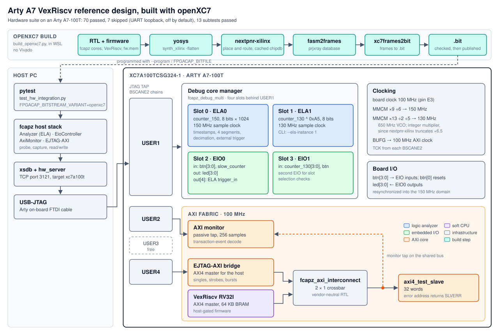

# Arty A7 with the open-source openXC7 flow

[`build_openxc7.py`](build_openxc7.py) builds the Arty A7 VexRiscv
reference design (`arty_a7_vex_top`) without Vivado. It uses the same RTL,
firmware and top level as `build_arty_vex.tcl`:

```
yosys synth_xilinx -> nextpnr-xilinx -> fasm2frames -> xc7frames2bit
```

The resulting bitstream passes the same hardware suite as the Vivado build:
70 passed and 7 skipped on an Arty A7-100T. Every core works through it: the
managed hub with two ELAs and two EIOs on USER1, the AXI monitor on USER2,
EJTAG-AXI on USER4, and the VexRiscv CPU.

<p align="center">
  
</p>

## Toolchain

The flow needs yosys plus the [openXC7](https://github.com/openXC7) tools:

- **yosys**, for example from oss-cad-suite;
- **nextpnr-xilinx** from `openXC7/nextpnr-xilinx`. Its
  `xilinx/external/prjxray-db` submodule is the database `--prjxray-db`
  points to;
- **prjxray** from `f4pga/prjxray`, for `xc7frames2bit` (a CMake build) and
  `utils/fasm2frames.py`. Install the `fasm` and `prjxray` Python packages
  into a virtualenv. Point `--fasm2frames` at `utils/fasm2frames.py`, because
  the installed `fasm2frames` entry point cannot import prjxray's own `utils`
  package.

The flow runs on Linux. On Windows, run it in WSL.

The hardware result above was built with yosys 0.66+94, nextpnr-xilinx
`bc9b234`, prjxray-db `a90f27c` and prjxray `c9f02d8`.

The chip database for `xc7a100tcsg324-1` takes about 70 s to build from the
nextpnr-xilinx sources. It is built once and kept in the build directory.

```bash
python examples/arty_a7/openxc7/build_openxc7.py \
    --prjxray-db ~/nextpnr-xilinx/xilinx/external/prjxray-db \
    --nextpnr-src ~/nextpnr-xilinx \
    --fasm2frames ~/prjxray/utils/fasm2frames.py \
    --xc7frames2bit ~/prjxray/build/tools/xc7frames2bit
FPGACAP_BITSTREAM_VARIANT=openxc7 \
    PYTHONPATH=host python -m pytest examples/arty_a7/test_hw_integration.py
```

Tools on `PATH` are found without flags; so are the matching environment
variables (`YOSYS`, `NEXTPNR_XILINX`, `FASM2FRAMES`, ...). `--skip-fw`
reuses an existing `vex/fw/fw.mem` when no RISC-V compiler is installed. A
full build takes about 6 minutes: yosys about 50 s, nextpnr about 4 minutes,
and fasm2frames about 80 s on its pure-Python parser.

## What the flow changes, and what to know

- **Async FIFO.** The EJTAG-AXI bridge's async FIFO defaults to Vivado's
  `xpm_fifo_async`. The script selects the portable behavioral FIFO with
  `chparam -set ASYNC_FIFO_IMPL 0`.
- **No `-abc9`.** With `synth_xilinx -abc9`, nextpnr-xilinx cannot place one
  CARRY4 chain whose `S[0]` and `CYINIT` come straight from a flip-flop.
  `--abc9` turns it back on.
- **Integer MMCM settings only.** nextpnr-xilinx truncates a fractional
  `CLKFBOUT_MULT_F`. With the old 130 MHz setting (6.5) that MMCM never
  locked, which held the managed hub in reset. The top now uses ×13 with
  `DIVCLK_DIVIDE` 2, which gives the same 650 MHz VCO.
- **Timing reports.** nextpnr's estimates for clk_100, clk_150 and clk_130
  fail (about 63, 103 and 108 MHz), yet the board passes the full suite at
  100, 150 and 130 MHz. The XDC has none of Vivado's asynchronous clock
  groups, so nextpnr also times the clock-crossing paths. And with no TCK
  constraint, the BSCANE2 clocks are checked against nextpnr's 12 MHz
  default. Read these figures as estimates from an unsigned-off flow, not as
  timing closure.
- **The AXI-monitor ELA's JTAG path.** nextpnr estimates 3.8 MHz for that
  ELA's TCK domain, against the 12 MHz default. The long path is a divide by
  the constant `WORDS_PER_SAMPLE` in `fcapz_ela.v`: Vivado optimizes it, but
  yosys builds an array divider. The ELA read correctly in the hardware suite
  at hw_server's default JTAG clock. That is the only JTAG clock tested.
- **Reduced XDC.** [`arty_a7_openxc7.xdc`](arty_a7_openxc7.xdc) has only the
  pins and the board clock. nextpnr reads `set_property` on ports and
  `create_clock` on ports or nets, so Vivado's TCK clock (on BSCANE2 pins)
  and its clock groups are left out.
